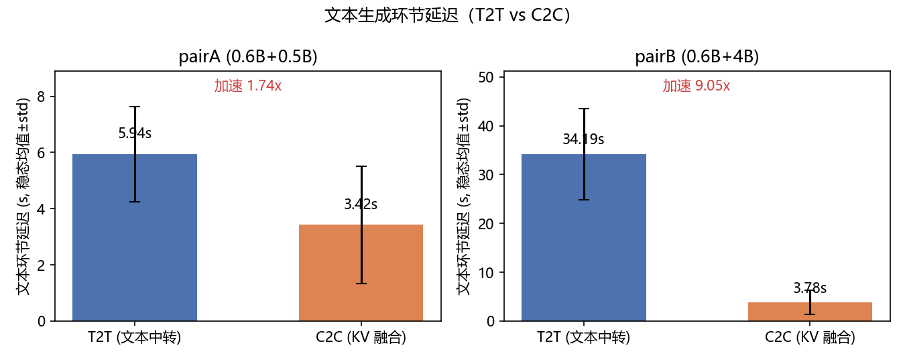
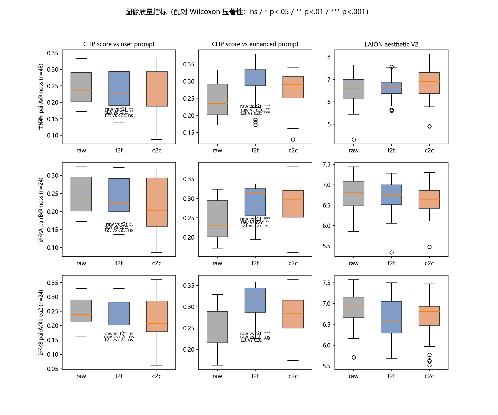
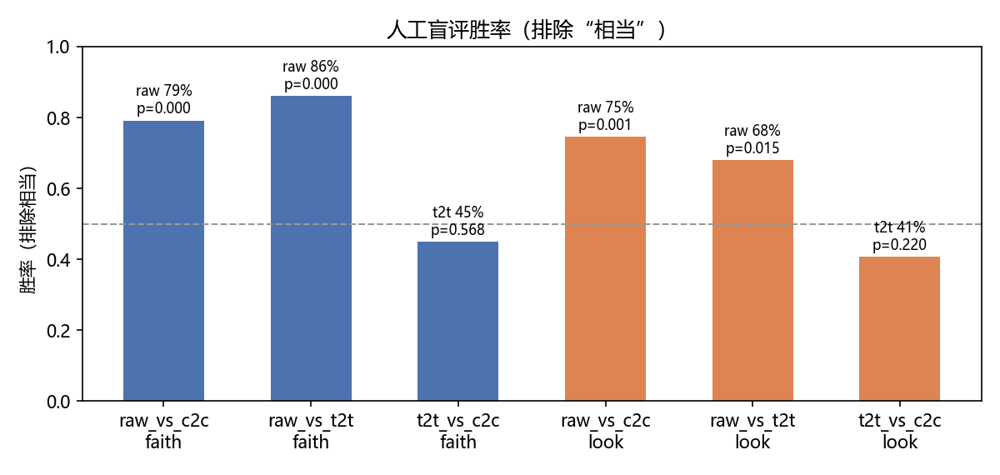
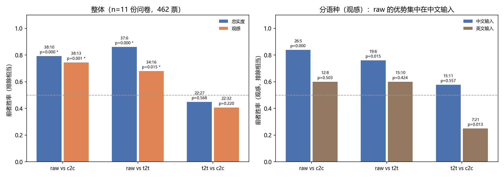
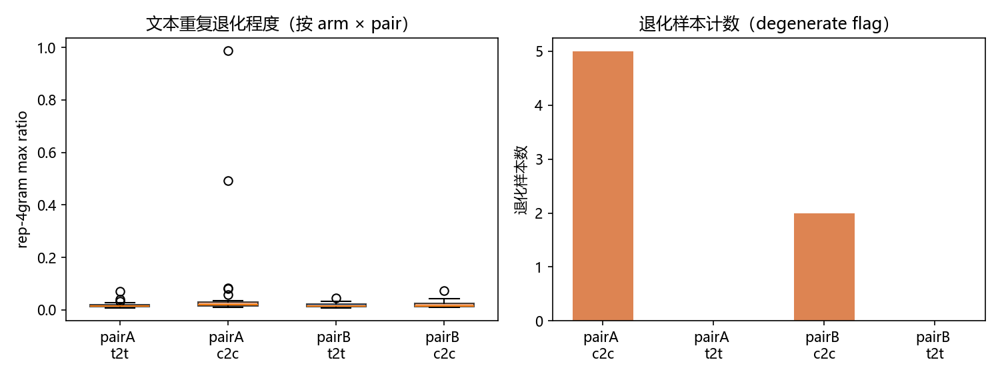

# C2C × 文生图 实验报告

> 把 Cache-to-Cache（KV-Cache 直传，arXiv:2510.03215 / ICLR'26）接进 ComfyUI 文生图prompt 生成环节，和文本中转（T2T）、raw 基线做对照。日期：2026-11-09（人评数据截至 2026-11-06）。环境：RTX 5070 Ti Laptop (12GB) / Windows / ComfyUI 0.43.2，推理零训练（原文预训练 fuser）。数据在 `results/metrics/`，图在 `report/figures/`。

## 1 背景与问题

Cache to Cache（C2C）让两个 LLM 直接融合 KV-Cache 传递语义，替代"Sharer 解码出分析文本、Receiver 再读"的文本中转（T2T）。论文自报延迟平均快 2.5×，但仅在 text generation 域验证过；文生图管线里 prompt 生成恰是 LLM 间语义传递的位置，是 C2C 的天然候选场景。本报告希望验证把 C2C 接进文生图 prompt 生成环节，2.5× 还成不成立、值不值得为它支付图像质量代价？意图对齐会不会因 KV 直传漂移（论文 A.4.6 提过 Sharer 语义误导）、失败模式长什么样、换 Sharer / 换 T2I 后端还成不成立。

实测零训练、零微调：直接用原文预训练 fuser，在 ComfyUI 工作流里对照三种处理——raw（用户 idea 直接喂 T2I）、t2t（Sharer 分析 → 文本中转 → Receiver 写 prompt）、c2c（Sharer 前向一次出 KV-Cache → 预训练 fuser 融进 Receiver → 写 prompt）。

## 2 实验设计

**表 1 组件配置**

| 组件 | pairA（主） | pairB（泛化 A：强 Sharer） |
|---|---|---|
| Receiver | Qwen3-0.6B | Qwen3-0.6B |
| Sharer | Qwen2.5-0.5B-Instruct | Qwen3-4B-Base |
| Fuser | `qwen3_0.6b+qwen2.5_0.5b_Fuser` | `qwen3_0.6b+qwen3_4b_base_Fuser` |
| 三种处理的 token 预算 | 统一 256 | 同左 |

**表 2 T2I 后端**

| 后端 | 配置 |
|---|---|
| moss（主+泛化A） | moodyMossMix fp8 + Qwen3.5-9B int8 TE（**TE 须改为 CPU**，上 GPU 会 OOM 崩）+ flux2-vae；1024²，25 steps，CFG 3.0，er_sde/simple |
| krea2（泛化B） | moodyKrea2MixUncensoredV8 nvfp4 + qwen3vl-4b-abliterated fp8 TE（CPU）+ qwen_image_vae；1024²，8 steps，CFG 1.0，euler/simple |

文本/图像解耦：prompt 由 bridge 批量生成（`results/prompts_generated/pairA|B.json`，含延迟与退化统计），图像批跑把文本作字面量嵌入工作流，零 LLM 调用，三种处理的 prompt 完全受控。

**表 3 实验矩阵**

| 矩阵 | 覆盖 | run 数 | 图数 | 用途 |
|---|---|---|---|---|
| 主矩阵 | pairA × moss × 28 prompt × 3 seed | 84 | 252 | 主结论（n=84 配对） |
| 泛化 A | pairB × moss × p01–p08 × 3 seed | 24 | 72 | 跨 Sharer 对 |
| 泛化 B | pairA × krea2 × p01–p08 × 3 seed | 24 | 72 | 跨 T2I 后端 |

28 条 prompt（中英 16/12；7 条基准 + 7 中文直译 + 7 换媒介 + 7 短句），seed 42/1042/2042，三种处理在同一 prompt×seed 下成对。132 个 run 全部完成，0 缺失，共 396 张无标签图。

指标：clip_user（图 vs 用户原始 prompt，主指标，防增强后偏离意图）、clip_enhanced（图vs 增强后 prompt，暴露长度混杂）、aesthetic（LAION V2）。文本侧：rep-4gram / distinct-1/2/3退化率、稳态/冷启动延迟、token 数。统计按 (prompt, seed) 配对，Wilcoxon signed-rank 双尾 +bootstrap 2000 次 95% CI + matched-pairs rank-biserial，α=.05。人工盲评：公开页https://repinkert.github.io/C2C-on-T2I/
详见 §3.4。

## 3 调查结果

### 3.1 延迟

**表 4 文本环节延迟**

| | 冷启动 load | T2T 稳态 | C2C 稳态 | 加速 |
|---|---|---|---|---|
| pairA（Sharer 0.5B） | 7.21s | 8.02s ± 3.57 | 3.70s ± 1.93 | 2.17× |
| pairB（Sharer 4B-Base） | 11.15s | 11.89s ± 3.93 | 3.46s ± 1.67 | 3.44× |

口径：文本批全 28 prompt 的稳态均值 ± std；冷启动为模型加载耗时，一次性。

T2T 的成本随 prompt 难度上涨（风格化长 prompt 让分析阶段变长，pairA 平均 8.02s）；C2C 的融合成本几乎不变（3.70s）。C2C 平均 91/90 token（pairA/pairB），t2t 平均 72——延迟优势不是靠少说话换来的。Sharer 越强，中转越是瓶颈，C2C 越省（pairB 3.44× > pairA 2.17×）。

单张扩散图 ~4min，文本环节省下的 4–8s 在一次性出图场景占比很小。C2C 的潜在价值在交互式prompt 预览、多候选筛选（文本环节在关键路径上）和批量管线上。

### 3.2 图像质量

**表 5 主矩阵配对 Wilcoxon（pairA@moss，n=84 配对）**

| metric | 对比 | diff | 95% CI | p | 结论 |
|---|---|---|---|---|---|
| clip_user | raw vs t2t | +0.0053 | [-0.002, 0.013] | 0.276 | 无显著差异 |
| clip_user | raw vs c2c | +0.0142 | [0.003, 0.027] | 0.054 | 边缘显著，raw 更贴意图 |
| clip_user | t2t vs c2c | +0.0089 | [~0, 0.018] | 0.058 | 边缘显著 |
| clip_enhanced | raw vs t2t | +0.0482 | [0.036, 0.061] | <0.001 | t2t 与自身文本更自洽 |
| clip_enhanced | raw vs c2c | +0.0384 | [0.023, 0.054] | <0.001 | t2t 与自身文本更自洽 |
| clip_enhanced | t2t vs c2c | +0.0098 | [0.002, 0.019] | 0.243 | 无显著差异 |
| aesthetic | t2t vs c2c | -0.0446 | [-0.18, 0.08] | 0.593 | 无显著差异 |
| aesthetic | raw vs c2c | +0.0846 | [-0.04, 0.22] | 0.229 | 无显著差异 |

- aesthetic 三项全部不显著，观感增益为零。
- clip_user 三个比较均为 raw ≥ t2t、raw ≥ c2c、t2t ≥ c2c，但 p∈[.054, .058]、效应量小，方向一致、强度存疑。
- clip_enhanced 两行 <0.001 是预期内现象（t2t 与自身文本天然更自洽；长度混杂）。
- 「增强即漂移」：两种增强处理都把图拉离了用户意图，与通信方式无关。

### 3.3 泛化

**表 6 分矩阵对比（t2t vs c2c）**

| 指标 | 主矩阵 pairA@moss | 泛化A pairB@moss | 泛化B pairA@krea2 |
|---|---|---|---|
| clip_user | +0.009 n.s. | -0.010 p=0.053 | -0.009 p=0.056 |
| clip_enhanced | +0.010 n.s. | **-0.011 p=0.034** | -0.005 n.s. |
| aesthetic | -0.045 n.s. | -0.275 p=0.152 | -0.146 p=0.095 |
| C2C 退化率 | 5/28 | 2/28 | （复用 pairA 文本） |

pairB（4B Sharer）上 clip_enhanced 方向整体翻转：raw vs c2c -0.023（p=0.027）、t2t vs c2c-0.011（p=0.034），即 c2c 图与增强后文本更合拍——这项指标有长度混杂（见 §3.1 token 数）。krea2 全部 n.s.，仅 clip_user t2t vs c2c 为 -0.009（p=0.056，c2c 反向边缘）。退化模式：p24 两 pair 复现，其余各自独立。

### 3.4 人评

协议：公开 Pages 单页 https://repinkert.github.io/C2C-on-T2I/
。每位受访者打开页面时用浏览器熵**随机重抽一份** 21 对（raw_vs_c2c / raw_vs_t2t / t2t_vs_c2c 各 7 对，21 个prompt 互不重复，顺序与左右全随机）；作答只存标签页内存，刷新即清空；答完 21/21 点"提交结果"自动 POST 到 Google Apps Script，追加进私密 Google Sheet；网络异常时仍可"导出 CSV"兜底。每对两问（忠实度/观感）三选一。

回收：**11 份完整问卷**（2026-11-05 至 11-06；昵称 9 份留空、2 份自填，42/42 × 11），合计 **462 票**，三种 pairwise × 两问各 **77 票**；结构校验通过——无重复 pair、无缺问项、无同臂对比、无缺失行。原始导出私密留存，匿名汇总见 `results/metrics/votes_summary.md|csv`；聚类校正、分语种与重叠度见 `results/metrics/votes_robust.md|csv`。

**表 7 人评汇总**（n=11，462 票；主口径为胜率排除"相当"，并列出"相当计半"口径）

| 比较 | 问题 | A 胜 | B 胜 | 相当 | 胜率A(排相当) | 胜率A(相当计半) | binomial p |
|---|---|---|---|---|---|---|---|
| raw_vs_c2c | 忠实度 | 38 | 10 | 29 | .792 | .682 | **<.0001** |
| raw_vs_c2c | 观感 | 38 | 13 | 26 | .745 | .662 | **.0006** |
| raw_vs_t2t | 忠实度 | 37 | 6 | 34 | .860 | .701 | **<.0001** |
| raw_vs_t2t | 观感 | 34 | 16 | 27 | .680 | .617 | **.015** |
| t2t_vs_c2c | 忠实度 | 22 | 27 | 28 | .449 | .468 | .568 |
| t2t_vs_c2c | 观感 | 22 | 32 | 23 | .407 | .435 | .220 |

- **raw 在两项比较里都领先；c2c 与 t2t 之间没有差别。** raw vs c2c：忠实度 38:10（.79，p<.0001）、观感 38:13（.75，p=.0006）；raw vs t2t：忠实度 37:6（.86，p<.0001）、观感 34:16（.68，p=.015）；t2t vs c2c 两问均不显著（.449 / .407，p=.57 / .22）。
- **稳健性**：留一位受访者重算，raw vs c2c 的 p 始终 ≤ .0045（忠实度下限 <1e-4），不依赖任何单一受访者。
- **聚类校正**（以 prompt 为单位，26–27 条）：同一 prompt 会被多人、多问重复评，票级 p 会高估显著性。校正后 raw vs t2t 忠实度 16:0（sign p<.0001，Wilcoxon p=.0004）、raw vs c2c 忠实度 15:5（sign p=.041，Wilcoxon p=.021）——raw 的优势仍成立，只是强度中等；t2t vs c2c 8:13（sign p=.38，Wilcoxon p=.33）维持无差异。
- **分语种：raw 的优势集中在中文输入。** 忠实度上 raw vs c2c 在中文 prompt 为 26:4（.87，p<.0001），在英文 prompt 为 12:6（.67，p=.24，该格 42 票里 24 票"相当"）；raw vs t2t 两种语言都领先（中文 .88、英文 .82）。

**表 8 分语种胜率（观感；票级与聚类级）**

| 比较 | 语种 | 决定性票 | 胜率 | 票级 p | 聚类 sign | 聚类 Wilcoxon |
|---|---|---|---|---|---|---|
| raw_vs_c2c | 中文 | 26:5 | .839 | **.0002** | 9:0（p=.004） | .004 |
| raw_vs_c2c | 英文 | 12:8 | .600 | .503 | 6:4（p=.754） | .200 |
| raw_vs_t2t | 中文 | 19:6 | .760 | **.015** | 7:1（p=.070） | .016 |
| raw_vs_t2t | 英文 | 15:10 | .600 | .424 | 7:3（p=.344） | .113 |
| t2t_vs_c2c | 中文 | 15:11 | .577 | .557 | 5:3（p=.727） | .742 |
| t2t_vs_c2c | 英文 | 7:21 | .250 | **.013** | 3:10（p=.092） | .092 |

- **原因：英文的"增强"几乎是复述，中文是整句重写。** 英文 prompt 本身已是长风格化描述（均 77 词），t2t/c2c 输出与其词集 Jaccard 为 .66 / .70，出图自然接近，于是大量"相当"；中文 prompt 只有均 11 词，t2t/c2c 输出 76 / 127 词、Jaccard ≈0，等于把整句重写并译成英文，漂移空间最大（表 9）。

**表 9 增强文本与原 prompt 的相似度（pairA，按语种）**

| 语种 | prompt 数 | raw 词数 | t2t 词数 | c2c 词数 | Jaccard(raw,t2t) | Jaccard(raw,c2c) |
|---|---|---|---|---|---|---|
| 中文 | 12 | 11.1 | 75.7 | 127.1 | .002 | .004 |
| 英文 | 16 | 77.4 | 73.8 | 70.9 | .656 | .698 |

- **t2t vs c2c 在英文上偏向 c2c 的迹象尚不足采信**：观感 7:21（.25，票级 p=.013），但聚类后 sign p=.09、Wilcoxon p=.09，该比较的语种交互 Fisher p=.026。方向值得记，样本量不足以当结论。
- **相当率 36%**（462 票中 167 票），但分布很不均：英文段 raw vs c2c 的 84 票里 46 票"相当"，中文段 70 票里只有 9 票——英文 prompt 下两张图常常难分高下。
- **κ 仍不可评估**：每个比较×问题里 ≥2 人共评的 item 只有 17–20 个（随机重抽所致），其两两一致率 .31–.59；在如此稀疏的重叠上 κ 不稳定，且有 rater 对全选"相当"使 κ 无定义。
- 解读边界：n=11、匿名自选（页面默认匿名，昵称可选）、无去重/防刷，**只能当 aggregate 趋势，不能当总体估计**。
- 与自动指标的关系：clip_user 三个比较同样 raw ≥ 两种处理（p 在边缘区），方向一致；aesthetic 无差异——自动指标没看出 c2c 的人眼增益，人评则给出 raw 的偏好，方向一致、强度不同。

## 4 讨论：失败模式

C2C 解码塌缩：pairA 5/28（p08、p10、p14、p21、p24），pairB 2/28（p09、p24），T2T 0/28。按塌缩形态归类：

**表 10 塌缩案例归类**

| 案例 | 类型 | distinct-2 | rep-4gram | 表现 | 跨 pair |
|---|---|---|---|---|---|
| p21 儿童绘本（en） | 循环塌缩 | 0.024 | 0.988 | "A whimsical, whimsical, whimsical…" 原地踏步 | 仅 pairA |
| p10 像素晾衣（zh） | 循环塌缩 | 0.055 | 0.493 | "16-bit pixelated, 16-bit pixelated…" 重复同一短语 | 仅 pairA |
| p14 工笔年夜饭（zh） | 元语言自指+弱重复 | 0.314 | 0.029 | "A detailed English image generation prompt: '…'" 递归嵌套 | 仅 pairA |
| p24 晾衣短句（zh） | 元语言自指+局部重复 | 0.146 | 0.082 | 同上 + "the laundry being caught in the wind…" 循环 | ✅ 两 pair |
| p08 夜市海报（zh） | 弱重复 | 0.271 | 0.082 | 句式高度雷同，被 distinct-2 捕获 | 仅 pairA |
| p09 水墨梯田（zh） | 弱重复 | 0.248 | 0.032 | "hills are arranged… The hills are covered…" | 仅 pairB |

p06（pairA）出现"Subject: / Action: / Setting: / Style: / Lighting: / Quality tags:"结构化格式泄漏，distinct-2 = 0.985、rep-4gram = 0.016，检测器完全抓不住，靠人工发现。跨 pair复现的只有 p24。

12 条中文输入里有 5 条至少一个 pair 塌了（42%），16 条英文里只有 p21（≈6%）。中文不是唯一凶手，但明显是放大器；两条整句原地踏步（p10、p21）都是**单一形容词短语原地踏步**，p14/p24 则是**把系统指令当成要抄录的目标**（元语言自指）。

工程兜底：检测器判据为 distinct-2 < 0.35（n>20）或 rep-4gram > 0.25；本批 7 个退化样本全部满足（p10/p21 双双超标，p08/p09/p14/p24 走 distinct-2 判据）；p06 全程漏检——检测必须配人工复核。

## 5 结论

回到开头的问题——2.5× 的收益在文生图里成立，但缩小且场景窄；图像质量的代价是真实的：

- 加速是真的：文本环节快 2.2×–3.4×，C2C 的融合成本几乎不随 prompt 变长而涨，T2T 则随难度涨得很快（§3.1）。
- 人眼不买账：盲评（n=11，462 票）raw 明显占优——raw>c2c 忠实度 .79 / 观感 .75（p<.0001 / .0006），raw>t2t .86 / .68（p<.0001 / .015）；而 c2c 与 t2t 之间没有差别（p ≥ .22）。raw 的优势集中在中文短 prompt 上（§3.4），自动指标 clip_user 方向一致（§3.2）。
- 「增强即漂移」（§3.2）且与通信方式无关；塌缩集中在中文输入（§4）。
- 换 Sharer（4B）/ 换 T2I 后端（krea2）均未改变结论（§3.3）。

因此在潜在的交互式 prompt 预览、多候选筛选、批量管线——文本环节在关键路径上，也许引入值得，但一次性出图（单张 ~4min）不值得。若要用：退化检测 + T2T 回退做成混合管线，优先英文提示。

## 6 局限与展望

1. 0.5B–4B 级 LLM + 5B 级 DiT，结论不能外推到 GPT 级 Sharer 或大型 T2I。
2. fuser 在 QA 数据上训练，文生图域完全 zero-shot，没做微调；中文提示没在 fuser 训练分布里。
3. 主矩阵 n=84、泛化 n=24；本批 prompt 全部风格化/长描述，难度高于自然句。
4. 长度混杂只用 clip_user/clip_enhanced 粗部分离，等 token 截断消融没做。
5. 人评 n=11（匿名自选、页面默认匿名、无去重），只能当 aggregate 趋势；合并后 raw 的偏好在聚类校正下仍成立，但 t2t vs c2c 的语言差异只是迹象，需更大样本复核。
6. 文本环节在扩散管线里不是瓶颈；落地场景是交互式预览 / 批量管线。
7. 本批 prompt 整体更难，raw 处理已很强，两种增强处理的增量空间被压缩。

展望：先在文生图域数据上自训（或对齐）fuser 看退化率能否压下来；工程上把退化检测 +T2T 回退做成混合管线；多 Sharer 融合（论文 A.5）做 prompt 生成的"专家委员会"；补等token 截断消融；试试 >4B Sharer 的延迟曲线；甚至把 cache 融合迁移到自回归图像生成器（文本-图像联合 KV 空间）上。

## 附录：原始数据与复现

| 文件 | 内容 |
|---|---|
| `results/metrics/manifest.csv` | 396 图 × 路径/prompt/arm/矩阵 |
| `results/metrics/image_metrics.csv` | clip_user / clip_enhanced / aesthetic |
| `results/metrics/text_stats.csv` | 延迟/token/退化统计（t2t/c2c 共 56 行） |
| `results/metrics/stats_pairs.csv` + `stats_summary.md` | 配对 Wilcoxon 全表 |
| `results/metrics/votes_summary.md` | 人评汇总（n=11，462 票；胜率/binomial/分评估者明细；不含原始票） |
| `results/metrics/votes_robust.md` | 聚类校正（prompt 级 sign/Wilcoxon）、分语种、item 重叠度、文本相似度 |
| `report/figures/fig_blind_lang.png` | 分语种胜率图（图 4） |
| `https://repinkert.github.io/C2C-on-T2I/` | 人评动态单页（随机重抽；数据已回收并入本报告） |
| `results/prompts_generated/pairA|B.json` | 三种处理的原始 prompt + 延迟明细 |
| `results/batch_log.txt` | 132 run 批跑日志 |
| `report/figures/gallery/` | 塌缩案例图（带标签拼接） |

复现手册见 fork 仓库的 `t2i/docs/REPRODUCE.md`。
