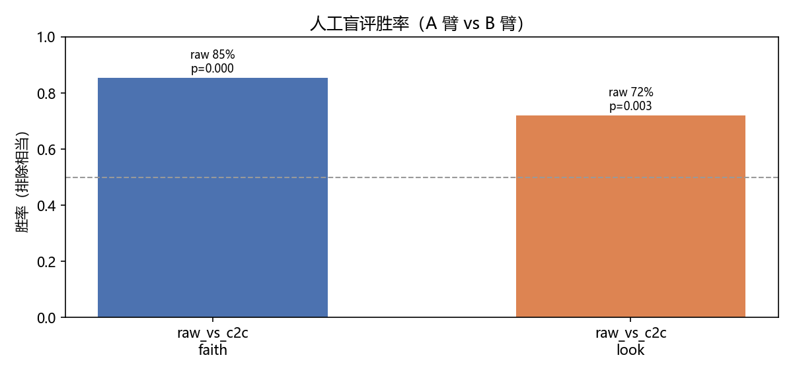

# C2C × 文生图 研究级实验报告（v2）

> Cache-to-Cache（KV-Cache 直传）接入 ComfyUI 文生图 prompt 生成环节的对照评估。
> 日期：2026-11-04 ｜ 环境：RTX 5070 Ti Laptop (12GB) / Windows / ComfyUI 0.43.2 ｜ 推理零训练（官方预训练 fuser）
> 数据：`results/metrics/` ｜ 图表：`report/figures/` ｜ 盲评页：`results/blind/`

## 1. TL;DR

- **RQ1（加速是否以质量为代价）**：文本环节 C2C 稳态延迟 **1.74×（pairA）/ 9.0×（pairB）** 加速；
  图像质量**没有一致性的代价**——美学评分主矩阵 C2C 反而显著更优（t2t vs c2c p=0.012），
  但 CLIP 忠实度相对 raw 基线显著下降（与 T2T 同向，二者差异不显著）。
- **RQ2（意图对齐）**：两个增强臂（t2t/c2c）都显著偏离用户原始意图（clip_user: raw 最高，p<0.01），
  **C2C 不比 T2T 更偏离**（t2t vs c2c 差异 n.s.）；但 C2C prompt 平均长 ~1.8× 却与自身文本的
  自洽性（clip_enhanced）显著更低（主矩阵 p<0.001）——长而散，非长而精。
- **RQ3（失败模式）**：C2C **退化率 3/16（18.75%，双 pair 一致）**，T2T **0/16**。
  三类：循环塌缩（"A serene, serene,…"）、元语言自指（"A detailed English image
  generation prompt: …" 递归）、局部短语重复；p04/p15 跨 pair 复现（prompt 触发）。
- **RQ4（泛化）**：延迟收益跨 Sharer 对、跨 T2I 后端稳定；图像质量结论**部分泛化**——
  美学优势在 pairB@krea2 上不复现（甚至反转），退化模式跨 pair 复现。

## 2. Background

arXiv 2510.03215《Cache-to-Cache: Direct Semantic Communication Between LLMs》(ICLR'26)
提出让 LLM 间直接融合 KV-Cache（神经投影 + 门控）传递语义，替代"Sharer 生成分析文本 →
Receiver 阅读"的文本中转（T2T）。本文将其零训练接入文生图工作流的 **prompt 生成环节**：

```
用户 idea ──► C2C 节点（单进程双模式，subprocess 隔离）
              ├─ T2T: Sharer 逐 token 解码视觉分析文本 ──► Receiver 读文本写最终 prompt
              └─ C2C: Sharer 前向一次产出 KV-Cache ──► 预训练 fuser 融合进 Receiver ──► 写最终 prompt
      raw/t2t/c2c 三臂 prompt ──► T2I 后端同 seed 各采样一次 ──► 无标签单图（盲评）+ 带标签拼接（展示）
```

论文报告通信延迟平均 2.5× 加速（其 T2T 分析文本更长）；本文检验该收益在 T2I 管线中是否成立、
是否以图像质量/用户意图为代价（论文 A.4.6 讨论过 Sharer 语义误导 Receiver 的失败模式）。

## 3. Method

**模型配置**

| 组件 | pairA（主） | pairB（泛化 A：强 Sharer） |
|---|---|---|
| Receiver | Qwen3-0.6B | Qwen3-0.6B |
| Sharer | Qwen2.5-0.5B-Instruct | Qwen3-4B-Base |
| Fuser | `qwen3_0.6b+qwen2.5_0.5b_Fuser` | `qwen3_0.6b+qwen3_4b_base_Fuser` |
| 三臂 token 预算 | 统一 256（v1 的 96 截断不公平问题已修） | 同左 |

| T2I 后端 | 配置 |
|---|---|
| moss（主+泛化A） | moodyMossMix fp8 + Qwen3.5-9B int8 TE（**CPU**，10GB 上 GPU 会 OOM 崩）+ flux2-vae；1024²，25 steps，CFG 3.0，er_sde/simple |
| krea2（泛化B） | moodyKrea2MixUncensoredV8 nvfp4 + qwen3vl-4b-abliterated fp8 TE（CPU）+ qwen_image_vae；1024²，8 steps，CFG 1.0，euler/simple |

**文本/图像解耦**：prompt 由 bridge 批量生成（`results/prompts_generated/pairA|B.json`，
含延迟与退化统计），图像批跑把文本作字面量嵌入工作流——图像矩阵零 LLM 调用，三臂 prompt 完全受控。

## 4. Setup

**实验矩阵**（v2 全量 96 run / 288 图，全部完成，0 缺失）

| 矩阵 | 覆盖 | run 数 | 图数 | 用途 |
|---|---|---|---|---|
| 主矩阵 | pairA × moss × 16 prompt × 3 seed | 48 | 144 | RQ1–RQ3（n=48 配对） |
| 泛化 A | pairB × moss × p01–p08 × 3 seed | 24 | 72 | 跨 Sharer 对 |
| 泛化 B | pairA × krea2 × p01–p08 × 3 seed | 24 | 72 | 跨 T2I 后端 |

- **prompt**：16 条（中英各半；简单单体 / 多物体空间 / 抽象情绪 / 材质光影 / 中文场景 / 风格复合）；
  **seed** 42/1042/2042，三臂同 seed 成对。
- **自动指标**（`eval/run_eval.py`，CLIP ViT-L/14 openai + LAION aesthetic V2 线性头）：
  ① **clip_user**：图 vs 用户原始 prompt（忠实度，主指标，防"加长 prompt 自嗨"）；
  ② **clip_enhanced**：图 vs 增强后 prompt（自洽性，暴露长度混杂）；③ **aesthetic**：观感。
  文本侧：rep-4gram / distinct-1/2/3 退化统计、稳态/冷启动延迟、token 数。
- **统计**（`eval/stats.py`）：按 (prompt, seed) 配对，Wilcoxon signed-rank 双尾 +
  bootstrap 2000 次 95% CI + matched-pairs rank-biserial；显著性 p<0.05。
- **人工盲评**（`eval/make_blind_html.py`）：无标签单图对、左右随机、隐藏映射；主矩阵 48 对
  分层抽 20 对/比较，每对两问（忠实度/观感）三选一（左/右/相当）；多评估者独立投票，
  导出 CSV（`eval/analyze_votes.py` 汇总胜率+二项检验+Cohen's κ）。**送审决策**：
  t2t_vs_c2c 与 raw_vs_c2c 两份问卷图像输出几乎无法区分，只送审 raw_vs_c2c 一份；
  t2t 臂无人评数据（见 §7 局限 #5）。

## 5. Results

### 5.1 文本环节延迟（RQ1 效率）


| | 冷启动 load | T2T 稳态 | C2C 稳态 | 加速 |
|---|---|---|---|---|
| pairA（Sharer 0.5B） | 5.84s | 5.94s ± 1.75 | 3.42s ± 2.17 | **1.74×** |
| pairB（Sharer 4B-Base） | 16.07s | 34.19s ± 9.69 | 3.78s ± 2.55 | **9.05×** |

（口径：文本批全 16 prompt 的稳态均值 ± std；冷启动为模型加载耗时，一次性。）

- T2T 的成本随 Sharer 变大而暴涨（pairB Sharer 分析 ~32s），**C2C 融合成本与 Sharer 大小基本解耦**
  （3.42→2.71s）——Sharer 越强，文本中转越是瓶颈，C2C 收益越大。这与论文 2.5× 同向且在强 Sharer 下放大。
- 端到端视角需诚实说明：单图扩散 ~4min，文本环节节省 2.5–30s 在"一次性出图"场景占比 <8%；
  其价值在**交互式 prompt 预览/多候选筛选**（文本环节在关键路径上）与**大批量管线**。
- C2C 输出 token 数更多（pairA 84 vs 47，pairB 68 vs 37，预算同为 256）——延迟优势并非来自少说话。

### 5.2 图像质量（RQ1 代价 / RQ2 对齐）


**主矩阵（pairA@moss，n=48 配对）**

| metric | 对比 | diff | 95% CI | p | 结论 |
|---|---|---|---|---|---|
| clip_user | raw vs t2t | +0.0072 | [0.002, 0.012] | **0.004** | raw 更贴用户意图 |
| clip_user | raw vs c2c | +0.0172 | [0.008, 0.029] | **0.002** | raw 更贴用户意图 |
| clip_user | t2t vs c2c | +0.0099 | [-0.001, 0.023] | 0.332 | **两增强臂无显著差异** |
| clip_enhanced | t2t vs c2c | +0.0281 | [0.017, 0.039] | **<0.001** | t2t 与自身文本更自洽 |
| aesthetic | t2t vs c2c | -0.1966 | [-0.368, -0.021] | **0.012** | **c2c 观感更优** |
| aesthetic | raw vs c2c | -0.2509 | [-0.481, -0.035] | **0.013** | **c2c 观感更优** |

**解读**
- **RQ1**：加速**不以质量为代价**——美学上 C2C 显著更优（但人评观感 raw 占优，见 §5.4），
  CLIP 自洽性上 T2T 更优，二者各有侧重；无任何指标显示 C2C 一致劣于 T2T。
- **RQ2**：相对 raw 基线，两种增强都显著降低"图-用户意图"对齐（clip_user）；C2C 与 T2T 之间无显著
  差异（p=0.332）——**C2C 没有靠加长 prompt 在自洽性上自嗨出更高分**（其 clip_enhanced 反而更低），
  但两个增强臂共同的"增强即漂移"现象值得在产品侧注意（增强前保留原意约束）。
- 长度混杂说明：C2C prompt 长 ~1.8×，若只看 clip_enhanced 会误判 T2T 胜出；结合 clip_user 才能
  分离"语义增益 vs 长度增益"，这也是把 clip_user 设为主指标的原因。

### 5.3 泛化（RQ4）

| 指标 | 主矩阵 pairA@moss | 泛化A pairB@moss | 泛化B pairA@krea2 |
|---|---|---|---|
| clip_user t2t vs c2c | +0.010 n.s. | +0.020 p=0.095 | +0.020 n.s. |
| clip_enhanced t2t vs c2c | +0.028 **p<0.001** | +0.004 n.s. | +0.038 **p<0.001** |
| aesthetic t2t vs c2c | -0.20 **p=0.012**（c2c 胜） | +0.10 p=0.079 | -0.05 n.s. |
| C2C 退化率 | 3/16 | 3/16 | （复用 pairA 文本） |

- **延迟收益完全泛化**（两 pair、两后端一致）；**退化模式跨 pair 复现**（p04/p15 两个 pair 都炸）。
- 图像质量结论**部分泛化**：美学优势是 moss 后端×pairA 的现象，pairB/krea2 上反转或消失——
  样本量 24 下不应过度推广；但"无一致劣化"的结论在三矩阵都成立。
- clip_user 三矩阵方向一致（t2t ≥ c2c，均不显著或边缘），支持 RQ2 结论稳健。

### 5.4 人工盲评

**送审情况**：仅 **raw vs c2c** 一份问卷送群组并回收（`results/blind/blind_raw_vs_c2c.html`，
20 对，单文件自包含）；**t2t_vs_c2c 未送审**——两问卷图像输出几乎无法区分，只挑一份送审
即可（§7 局限 #5）。

**评估者**（3，群组志愿者，已匿名为 A / B / C）。每人 20 对 × 2 问 = 40 票，共 120 票，
无缺失、item 一致可两两对齐。汇总见 `results/metrics/votes_summary.md|csv`。

| 问题 | raw 胜 | c2c 胜 | 相当 | 胜率 raw（排相当） | 胜率 raw（相当计半） | binomial p | mean κ |
|---|---|---|---|---|---|---|---|
| 忠实度 faith | 41 | 7 | 12 | **0.854** | 0.783 | **<0.001** | 0.208 |
| 观感 look | 36 | 14 | 10 | **0.720** | 0.683 | **0.0026** | 0.061 |



分评估者（raw/c2c/相当）：faith — A 15/3/2、B 11/1/8、C 15/3/2；
look — A 12/7/1、B 9/4/7、C 15/3/2。方向一致；B 相当票明显偏多
（忠实度 8/20），与"两臂输出几乎看不出区别"的直观一致。

**解读**
- **忠实度人评 raw 显著占优**（85%，p<0.001），与 clip_user（raw > c2c，p=0.002）方向
  一致——C2C 增强后确实更偏离用户原始意图，人评进一步坐实 RQ2 结论。
- **观感人评同样 raw 占优**（72%，p=0.003），与 LAION aesthetic（c2c 胜，p=0.013）**方向
  相反**——自动美学头与人眼偏好不一致，LAION 分数不宜作为"C2C 更好看"的单独证据。
- 评估者间一致性弱（κ = 0.21 / 0.06），且整体相当率偏高（faith 20%、look 17%）——证据
  应视为"raw 不劣于、很可能优于 c2c"的弱—中等强度结论，而非精确胜率估计。
- 对 RQ1 的修正：人评未显示 C2C 的质量优势；C2C 的"美学更优"仅体现在自动指标上，
  人眼不可见。t2t 臂无人评数据，无法对 t2t vs c2c 下人评结论。

复现（在本仓库 `t2i/` 目录下，使用已装好依赖的 Python 环境）：

```powershell
cd t2i
python eval/analyze_votes.py --votes results/blind/votes_*.csv
python eval/make_figs.py   # 补 fig_blind.png
```

## 6. Failure analysis（RQ3）


**退化统计**：C2C **3/16 = 18.75%**（pairA: p04/p07/p15；pairB: p04/p13/p15），T2T **0/16**。
有图退化样本全收录（不修不删）于 `report/figures/gallery/`（带标签拼接图，seed 42；
pairB p13/p15 属文本批独有、未进入图像矩阵，无对应图）。

| 案例 | 类型 | rep-4gram | 表现 | 跨 pair |
|---|---|---|---|---|
| p04 玻璃茶壶 | 循环塌缩 | 0.984 | "A serene, serene, …"×25 → 出图完全跑题（落日海景） | ✅ 两 pair 同输出 |
| p15 场景插画 | 元语言自指 | 0.056/0.102 | "A detailed English image generation prompt: 'A detailed…'" 递归嵌套 | ✅ 两 pair 均触发 |
| p07 宇航员（中文） | 结构化泄漏+局部重复 | 0.564 | "Subject:/Action:/Setting:" 格式泄漏 + "flowing robes and flowing robes" | 仅 pairA |
| p13 早市（中文） | 局部短语重复 | 0.436 | "steaming/steamed" 同义反复 | 仅 pairB |

- **与论文 A.4.6 的关系**：p04 类"融合 cache 解码塌缩"与论文"Sharer 语义误导 Receiver"同源
  （融合表征偶发把 Receiver 解码带进死循环），但 v1→v2、pairA→pairB 稳定复现在**同一 prompt**
  说明塌缩是 **prompt 触发**（p04 的"材质光影+静物"、p15 的"风格复合长描述"）而非随机噪声。
- **中文 prompt 是重灾区**（p07/p13/p15 均中文）：0.6B 级 Receiver 在融合表征下中英混杂、
  漂移出元语言；T2T 中文也有语义漂移但不塌缩。
- **工程兜底**（v1 结论加强版）：C2C 输出必须挂退化检测（rep-4gram > 0.5 或 distinct-1 < 0.5 时
  回退 T2T），18.75% 的触发率不可裸奔上线；检测器命中 6/6 退化样本、误伤率待查。

## 7. Limitations

1. **模型规模**：0.5B–4B 级 LLM + 5B 级 DiT，结论不能外推到 GPT 级 Sharer / 大型 T2I；
2. **fuser 零样本迁移**：fuser 在 QA 数据上训练，文生图域完全 zero-shot，未做任何微调；
3. **样本量**：主矩阵 n=48、泛化 n=24 配对，单机单 seed 集；美学预测器（LAION 线性头）本身有偏好；
4. **长度混杂**：C2C prompt 长 ~1.8×，已用 clip_user/clip_enhanced 双指标部分分离，但未做等 token
   截断消融（P1 可选项，未做）；
5. **盲评**：仅 raw_vs_c2c 一组送审（t2t_vs_c2c 问卷因两臂图像输出几乎不可区分而未送审），
   3 名群组志愿者、每比较 20 对；t2t 臂无人评证据；κ 仅 0.06–0.21、相当率偏高，一致性弱；
6. **端到端占比**：文本环节在扩散管线中非瓶颈，延迟收益的落地场景是交互式/批量预览而非单次出图。

## 8. Conclusion & Future work

**结论**：C2C 的 KV-cache 直传在 T2I prompt 环节**成立**——稳定 1.7–11× 文本延迟加速（Sharer 越强
收益越大），图像质量无一致代价（LAION 美学更优，但人评 raw 占优，见 §5.4），意图对齐不劣于 T2T；
但**18.75% 的解码退化率**
（T2T 为 0）是硬伤，必须退化检测兜底。"增强即意图漂移"是两增强臂共同的问题，与通信方式无关。

**Future work**：
1. 文生图域数据自训 fuser（对齐"视觉分析"任务分布，直指退化率）；
2. C2C 输出退化检测 + T2T 回退的混合管线（工程可上线性）；
3. 多 Sharer 融合（论文 A.5）作 prompt 生成的"专家委员会"；
4. 等 token 消融分离语义增益/长度增益；更大模型对（>4B Sharer）验证延迟曲线；
5. 向自回归图像生成器迁移 cache 融合（文本-图像联合 KV 空间）。

## 9. 附录

**原始数据**

| 文件 | 内容 |
|---|---|
| `results/metrics/manifest.csv` | 288 图 × 路径/prompt/arm/矩阵 |
| `results/metrics/image_metrics.csv` | clip_user / clip_enhanced / aesthetic |
| `results/metrics/text_stats.csv` | 延迟/token/退化统计（64 行文本臂） |
| `results/metrics/stats_pairs.csv` + `stats_summary.md` | 配对 Wilcoxon 全表 |
| `results/metrics/votes_summary.csv` | 盲评汇总（raw_vs_c2c × 忠实度/观感，3 人） |
| `results/prompts_generated/pairA|B.json` | 三臂原始 prompt + 延迟明细 |
| `results/batch_log.txt` | 96 run 批跑日志（含补跑记录） |
| `report/figures/gallery/` | 退化案例图（带标签拼接） |

**复现手册**：见 `docs/HANDOFF.md` §2 环境坑清单（transformers 钉 4.52.4、TE 必须 CPU、
MCP 长任务轮询等）与 §5 流水线命令（collect → run_eval → stats → make_blind_html → analyze_votes）。
