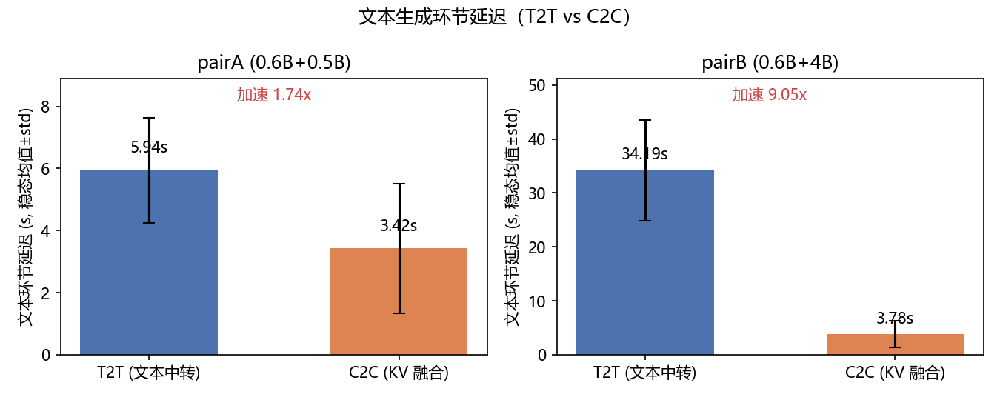
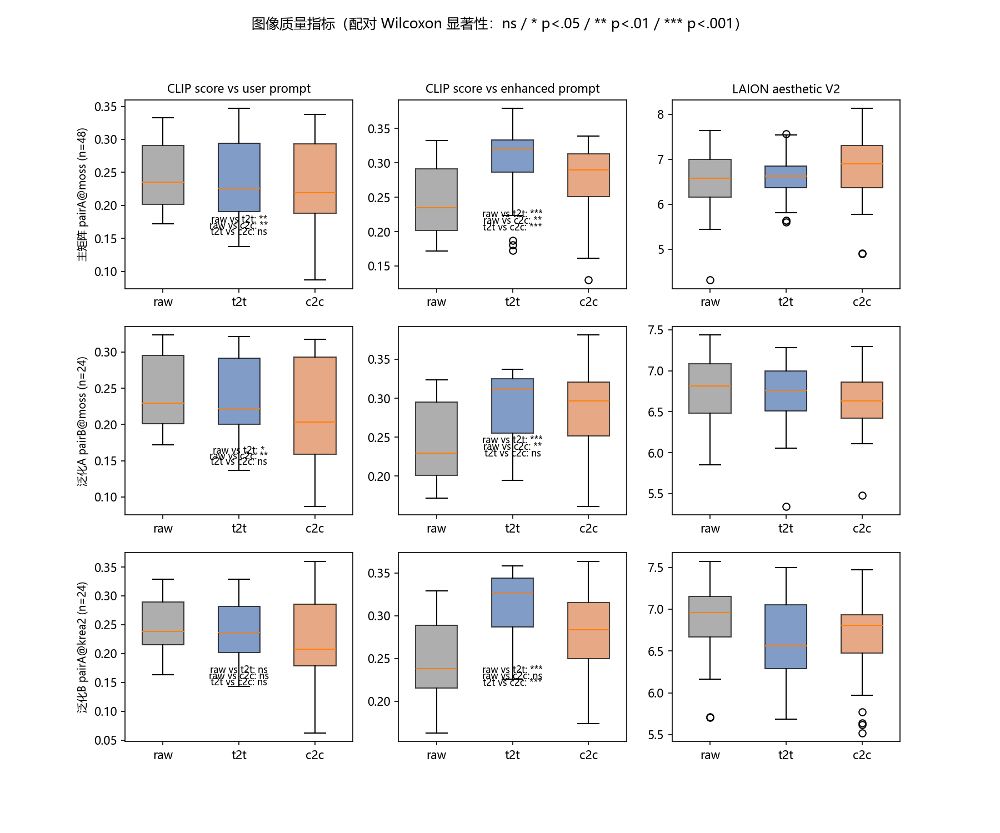
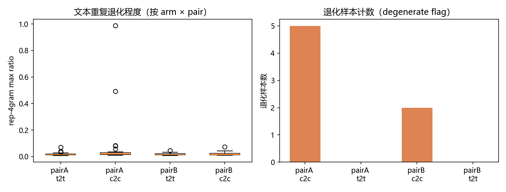

# C2C × 文生图 实验报告（v3）

> 把 Cache-to-Cache（KV-Cache 直传，arXiv 2510.03215 / ICLR'26）接进 ComfyUI 文生图 prompt
> 生成环节，和文本中转（T2T）、raw 基线做对照。日期：2026-11-05。
> 环境：RTX 5070 Ti Laptop (12GB) / Windows / ComfyUI 0.43.2，推理零训练（官方预训练 fuser）。
> 数据在 `results/metrics/`，图在 `report/figures/`。

## 先说做这件事的经过

论文这套东西的核心是让两个 LLM 直接融合 KV-Cache 传递语义，替代"Sharer 先解码出分析文本、
Receiver 再读"的文本中转。论文自己的数字是通信延迟平均快 2.5×。我们想知道这个收益放到文生图
管线里还成不成立，以及要不要为它支付图像质量的代价。论文 A.4.6 提过 Sharer 语义误导 Receiver
的失败模式，但没人在生成式视觉任务上实测过。

这份 v3 是全量重跑的结果。第一版 v1 只跑了 8 个 prompt，发现 T2T 的 Sharer 分析被 96 token 截断、
n 也撑不起结论；v2 把预算统一到 256、扩成 16 条手配 prompt、补了 raw 基线和人工盲评。v2 之后我们
把全部图和指标删了，换成一套手工设计的 28 条 prompt 重新跑。旧集太短、太"自然句"（fox in snow），
看不出增强臂在复杂风格化输入上的行为。现在 28 条分成四组：7 条基准（电影海报式夜市、雨后水墨梯田、
像素立面、铜壶包装、复古雨伞海报、夜林兽眼、工笔年夜饭），7 条中文直译，7 条媒介/风格切换，
7 条短句版。中文占比 12/28。

## 我们做了什么

三臂对照：raw（用户 idea 直接喂 T2I）、t2t（Sharer 分析 → 文本中转 → Receiver 写 prompt）、
c2c（Sharer 前向一次出 KV-Cache → 预训练 fuser 融进 Receiver → 写 prompt）。模型配置：

| 组件 | pairA（主） | pairB（泛化 A：强 Sharer） |
|---|---|---|
| Receiver | Qwen3-0.6B | Qwen3-0.6B |
| Sharer | Qwen2.5-0.5B-Instruct | Qwen3-4B-Base |
| Fuser | `qwen3_0.6b+qwen2.5_0.5b_Fuser` | `qwen3_0.6b+qwen3_4b_base_Fuser` |
| 三臂 token 预算 | 统一 256 | 同左 |

| T2I 后端 | 配置 |
|---|---|
| moss（主+泛化A） | moodyMossMix fp8 + Qwen3.5-9B int8 TE（**TE 必须 CPU**，上 GPU 会 OOM 崩）+ flux2-vae；1024²，25 steps，CFG 3.0，er_sde/simple |
| krea2（泛化B） | moodyKrea2MixUncensoredV8 nvfp4 + qwen3vl-4b-abliterated fp8 TE（CPU）+ qwen_image_vae；1024²，8 steps，CFG 1.0，euler/simple |

文本/图像解耦：prompt 由 bridge 批量生成（`results/prompts_generated/pairA|B.json`，含延迟与
退化统计），图像批跑把文本作字面量嵌入工作流，零 LLM 调用，三臂 prompt 完全受控。

实验矩阵：

| 矩阵 | 覆盖 | run 数 | 图数 | 用途 |
|---|---|---|---|---|
| 主矩阵 | pairA × moss × 28 prompt × 3 seed | 84 | 252 | RQ1–RQ3（n=84 配对） |
| 泛化 A | pairB × moss × p01–p08 × 3 seed | 24 | 72 | 跨 Sharer 对 |
| 泛化 B | pairA × krea2 × p01–p08 × 3 seed | 24 | 72 | 跨 T2I 后端 |

28 条 prompt（中英 16/12；7 条基准 + 7 中文直译 + 7 换媒介 + 7 短句），seed 42/1042/2042，
三臂同 seed 成对。132 个 run 全部完成，0 缺失，共 396 张无标签图。

指标三个：clip_user（图 vs 用户原始 prompt，主指标，防增强后偏离意图）、clip_enhanced（图 vs
增强后 prompt，用来暴露 C2C 长文本带来的长度混杂）、aesthetic（LAION V2）。文本侧统计
rep-4gram / distinct-1/2/3 退化率、稳态/冷启动延迟、token 数。统计按 (prompt, seed) 配对，
Wilcoxon signed-rank 双尾 + bootstrap 2000 次 95% CI + matched-pairs rank-biserial，显著性 p<0.05。

人工盲评：单页 21 对（`results/blind/blind_compare_all.html`），三个 pairwise 比较各 7 对
（raw_vs_c2c、raw_vs_t2t、t2t_vs_c2c），21 个 prompt 互不重复；左右随机、隐藏映射；每对两问
（忠实度/观感）三选一。详见「人评」一节。

## 先把结论说在前头

文本环节快 2.2×（pairA）到 3.4×（pairB）。图像质量上 raw 略优于两个增强臂（clip_user，边缘
显著），两个增强臂彼此分不出；aesthetic 上谁都没出线。C2C 有 7/56 的文本解码塌缩
（pairA 5/28、pairB 2/28，中文提示为主），T2T 为 0。泛化矩阵里 pairB@moss 上
clip_enhanced 方向翻转，C2C 显著更自洽（p=0.034）。人评第二轮重收中。

一起看：加速是真的（这次小一些，因为新 prompt 本身更长、T2T 的分析也更长）；质量上 C2C 没有
一致劣于 T2T，但也看不出有人眼可见的增益；中文输入仍是解码塌缩的重灾区。

## 延迟

| | 冷启动 load | T2T 稳态 | C2C 稳态 | 加速 |
|---|---|---|---|---|
| pairA（Sharer 0.5B） | 7.21s | 8.02s ± 3.57 | 3.70s ± 1.93 | 2.17× |
| pairB（Sharer 4B-Base） | 11.15s | 11.89s ± 3.93 | 3.46s ± 1.67 | 3.44× |

口径：文本批全 28 prompt 的稳态均值 ± std；冷启动为模型加载耗时，一次性。

T2T 的成本随 prompt 难度涨得很快。这些风格化长 prompt 让分析阶段变长（pairA 平均 8.02s，
对比 v2 的 5.94s）。C2C 的融合成本几乎不变（3.70s）。token 数：C2C 平均 91（pairA）/ 90（pairB），
T2T 平均 72（两 pair 相近）。延迟优势不是靠少说话换来的，C2C 说的还是更多。

端到端我们得诚实说一句：单张扩散图 ~4min，文本环节省下的 4–8s 在一次性出图场景占比很小。
（这两个 prompt 集分布完全不同，v2→v3 的数字不能直接对拍，但方向一致：Sharer 越强，文本中转越是瓶颈，C2C 越省。）C2C 的价值在交互式 prompt 预览、多候选筛选（文本环节在关键路径上）和
批量管线上。

## 图像质量

主矩阵（pairA@moss，n=84 配对）：

| metric | 对比 | diff | 95% CI | p | 结论 |
|---|---|---|---|---|---|
| clip_user | raw vs t2t | +0.0053 | [-0.002, 0.013] | 0.276 | 无显著差异 |
| clip_user | raw vs c2c | +0.0142 | [0.003, 0.027] | 0.054 | 边缘显著，raw 更贴意图 |
| clip_user | t2t vs c2c | +0.0089 | [~0, 0.018] | 0.058 | 边缘显著 |
| clip_enhanced | raw vs t2t | +0.0482 | [0.036, 0.061] | <0.001 | t2t 与自身文本更自洽 |
| clip_enhanced | raw vs c2c | +0.0384 | [0.023, 0.054] | <0.001 | t2t 与自身文本更自洽 |
| clip_enhanced | t2t vs c2c | +0.0098 | [0.002, 0.019] | 0.243 | 无显著差异 |
| aesthetic | t2t vs c2c | -0.0446 | [-0.18, 0.08] | 0.593 | 无显著差异 |
| aesthetic | raw vs c2c | +0.0846 | [-0.04, 0.22] | 0.229 | 无显著差异 |

逐项说：

- 没有哪项在 0.05 上翻车到需要"C2C 劣于 T2T"的地步，但也没有 v2 那种"aesthetic 显著偏向 c2c"。
  这次 aesthetic 三项全部不显著。v2 的主结论（C2C 观感更优，p=0.012）在更难的 prompt 上没复现。
- clip_user 仍然三个比较都是 t2t ≥ c2c、raw ≥ 两臂，但 p 值都在边缘区（0.054 / 0.058），
  效应量也小。可以说"方向一致、强度存疑"，说不出显著。
- clip_enhanced 两行 <0.001 是预期内现象（t2t 与自身文本天然更自洽；长度混杂）。
- 「增强即漂移」仍然站得住：两个增强臂都把图拉离了用户意图，和通信方式无关。

## 泛化

| 指标 | 主矩阵 pairA@moss | 泛化A pairB@moss | 泛化B pairA@krea2 |
|---|---|---|---|
| clip_user t2t vs c2c | +0.009 n.s. | -0.010 p=0.053 | -0.009 p=0.056 |
| clip_enhanced t2t vs c2c | +0.010 n.s. | **-0.011 p=0.034** | -0.005 n.s. |
| aesthetic t2t vs c2c | -0.045 n.s. | -0.275 p=0.152 | -0.146 p=0.095 |
| C2C 退化率 | 5/28 | 2/28 | （复用 pairA 文本） |

pairB（4B Sharer）上 clip_enhanced 的方向整体翻转：raw vs c2c -0.023（p=0.027）、t2t vs c2c
-0.011（p=0.034），也就是 c2c 图与增强后文本更合拍。这和 v2 的"Sharer 越强 C2C 越吃香"方向
一致（当然，这项指标有长度混杂：c2c prompt 平均 90 token、t2t 72）。krea2 全部 n.s.，仅
clip_user t2t vs c2c 为 -0.009（p=0.056，c2c 反向边缘）。退化模式：p24 跨 pair 复现，
其余各自独立。

## 人评

**状态：第二轮已发布（动态随机抽样页），等回收。**第一轮盲评（n=3，仅 raw_vs_c2c）已全部
作废、数据已删除。

第二轮协议：公开 Pages 单页 https://repinkert.github.io/C2C-on-T2I/。每位受访者打开页面时，
页面用浏览器熵**随机重抽一份** 21 对（raw_vs_c2c / raw_vs_t2t / t2t_vs_c2c 各 7 对，21 个
prompt 互不重复，每场顺序与左右全随机）。所有作答只存于当前标签页内存，**刷新/关闭即清空**，
无 localStorage；完成后导出 CSV（格式与 eval/analyze_votes.py 兼容）。**分析口径**：aggregate
臂胜率按汇总票数做 binomial 检验；κ（跨受访者同 item 一致性）不可计算（每人仅评 21 对且
各不同），报告中如实说明。防刷/去重：无任何手段，匿名自愿，解读以 aggregate 趋势为限。

## 失败模式

C2C 解码塌缩：pairA 5/28（p08、p10、p14、p21、p24），pairB 2/28（p09、p24），T2T 0/28。
按塌缩形态归类：

| 案例 | 类型 | distinct-2 | rep-4gram | 表现 | 跨 pair |
|---|---|---|---|---|---|
| p21 儿童绘本（en） | 循环塌缩 | 0.024 | 0.988 | "A whimsical, whimsical, whimsical…" 原地踏步 | 仅 pairA |
| p10 像素晾衣（zh） | 循环塌缩 | 0.055 | 0.493 | "16-bit pixelated, 16-bit pixelated…" 重复同一短语 | 仅 pairA |
| p14 工笔年夜饭（zh） | 元语言自指+弱重复 | 0.314 | 0.029 | "A detailed English image generation prompt: '…'" 递归嵌套 | 仅 pairA |
| p24 晾衣短句（zh） | 元语言自指+局部重复 | 0.146 | 0.082 | 同上 + "the laundry being caught in the wind…" 循环 | ✅ 两 pair |
| p08 夜市海报（zh） | 弱重复 | 0.271 | 0.082 | 句式高度雷同，被 distinct-2 捕获 | 仅 pairA |
| p09 水墨梯田（zh） | 弱重复 | 0.248 | 0.032 | "hills are arranged… The hills are covered…" | 仅 pairB |

p06（pairA）出现"Subject: / Action: / Setting: / Style: / Lighting: / Quality tags:"结构化
格式泄漏，distinct-2 = 0.985、rep-4gram = 0.016，检测器完全抓不住，靠人工发现——v1/v2 的 p07
同族案例。跨 pair 复现的只有 p24。

12 条中文输入里有 5 条至少一个 pair 塌了（p08/p09/p10/p14/p24），16 条英文里只有 p21 塌了。
按 prompt 计：中文 5/12 = 42%，英文 1/16 ≈ 6%。中文不是唯一凶手，但明显是放大器；
两条活蹦乱跳的塌缩（p10、p21）都是**单一形容词/形容词短语原地踏步**，p14/p24 则是
**把系统指令当成要抄录的目标**（元语言自指）。

工程兜底：检测器实际判据是 distinct-2 < 0.35（n>20）或 rep-4gram > 0.25。本批 7 个退化样本
全部满足（p10/p21 双双超标，p08/p09/p14/p24 走 distinct-2 判据）；p06 全程漏检。

## 局限

1. 0.5B–4B 级 LLM + 5B 级 DiT，结论不能外推到 GPT 级 Sharer 或大型 T2I。
2. fuser 在 QA 数据上训练，文生图域完全 zero-shot，没做微调；中文提示没在 fuser 训练分布里。
3. 主矩阵 n=84、泛化 n=24；新 prompt 集全部风格化/长描述，和 v2 的"fox in snow"不是一个
   分布，跨版本结论不能直接对拍。
4. 长度混杂只用 clip_user/clip_enhanced 粗部分离，等 token 截断消融没做。
5. 人评第二轮重收中，现在没有可用的人评数据支撑。
6. 文本环节在扩散管线里不是瓶颈。落地场景是交互式预览 / 批量管线。
7. 新 prompt 集整体"更难"，raw 臂已很强。增强臂的增量空间被压缩；v2 的 aesthetic 结论
   在这批上没复现，也可能是这一原因。

## 接下来想做的

如果再往下推一步：先在文生图域数据上自训（或对齐）fuser，看看退化率能不能压下来；工程上把
退化检测 + T2T 回退做成混合管线；多 Sharer 融合（论文 A.5）做 prompt 生成的"专家委员会"；
补等 token 截断消融；试试 >4B Sharer 的延迟曲线；甚至把 cache 融合迁移到自回归图像生成器
（文本-图像联合 KV 空间）上。

## 附录：原始数据与复现

| 文件 | 内容 |
|---|---|
| `results/metrics/manifest.csv` | 396 图 × 路径/prompt/arm/矩阵 |
| `results/metrics/image_metrics.csv` | clip_user / clip_enhanced / aesthetic |
| `results/metrics/text_stats.csv` | 延迟/token/退化统计（56 行文本臂） |
| `results/metrics/stats_pairs.csv` + `stats_summary.md` | 配对 Wilcoxon 全表 |
| `results/blind/blind_compare_all.html` | 盲评第二轮单页（21 对；回收后更新） |
| `results/prompts_generated/pairA|B.json` | 三臂原始 prompt + 延迟明细 |
| `results/batch_log.txt` | 132 run 批跑日志 |
| `report/figures/gallery/` | 退化案例图（带标签拼接） |

复现手册见 `docs/HANDOFF.md`（公开版见 fork 仓库的 `t2i/docs/REPRODUCE.md`）。
